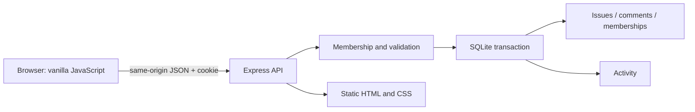

# Architecture: the smallest useful transaction boundary

## 1. One app, one relational database

Express 5 hosts static assets and JSON endpoints. JavaScript ES modules are used throughout. SQLite holds users, sessions, projects, membership, issues, comments, and activity. Foreign keys enforce references; checks enforce valid states. Schema version 1 is created and seeded transactionally, so restart neither duplicates samples nor revives deleted membership. A newer unknown schema is rejected rather than silently modified.

The installed runtime was verified directly, then checked against the [Node 22.16 SQLite documentation](https://nodejs.org/download/release/v22.16.0/docs/api/sqlite.html). `DatabaseSync` makes transactions easy to read but blocks the Node event loop while SQL executes. That is an intentional local-app tradeoff. PostgreSQL plus an asynchronous driver becomes a better fit when sustained concurrent writers, deployment across machines, or latency under database contention becomes a real requirement. Passing a two-process correctness test does not establish high throughput.

Vanilla browser JavaScript avoids a compile step and lets the learner trace a click to a request and a SQL transaction. The client is split into plain ES modules by responsibility (transport, state, rendering, dialogs — see the README's module list) so that path stays readable. React was considered; it would help once UI composition and state complexity outweighed the value of this direct path. Avoiding a framework does not eliminate state races; browser request generations still need careful handling.

## 2. Identity and authorization are different

Demo login deliberately lets a local user impersonate four seeded accounts. The server creates a random session token, stores only its SHA-256 hash, and sets an HttpOnly SameSite=Strict cookie with seven-day expiry. Sessions survive process restart and are revoked on logout or switching the same browser session. Because this is loopback HTTP, the cookie does not have the HTTPS-only Secure attribute.

Authorization is enforced on the API for every data route. Read requests require membership; writes require editor/owner; membership changes require owner. Guessing an issue ID from another project yields 404. Mutation authorization is checked inside the same write transaction as the change, preventing a second process from revoking membership between the check and write. A project can never lose its final owner through the membership API.

The loopback Host allowlist blocks hostile DNS names. Mutations require a custom request header and matching Origin when one is supplied; cross-site Fetch Metadata is rejected. CORS is not enabled. These are local-demo protections, not a substitute for production authentication, TLS, rate limits, deployment configuration, or an independent security assessment.

## 3. A version is a precondition, not decoration

Every issue carries an integer version. A client reads version 4, edits a draft, and sends version 4 with its PATCH. SQL updates only `WHERE id=? AND version=?`, incrementing the version in the same statement. A second client trying version 4 after the first writer commits gets 409 and the current issue. It cannot silently overwrite version 5.

`BEGIN IMMEDIATE` serializes SQLite writers before reading mutable state. A five-second busy timeout bounds lock waiting. Each successful mutation and its activity event commit together. A failure during activity insertion rolls back the issue and even the per-project number allocation. The unique `(project_id, number)` constraint provides another guard against duplicate keys.

Comments are independent append operations; adding a comment does not invalidate a user's issue-field draft. Removing a member clears that user's active assignments and increments affected issue versions so open editors must reconcile. Soft archive also checks the version; stale deletes cannot hide newer work. Archived issues retain comments and activity but disappear from active endpoints.

## 4. UI refresh must not become an accidental writer

Board refresh reads persisted state. Form saves are explicit, pessimistic requests: the browser should report success only after the server commits. A stale edit is not automatically retried using a fresh version. The user sees the conflict and chooses when to replace their draft with current server fields. The browser renders user input as text, not executable HTML.

There is no WebSocket broker or distributed event log. Polling is sufficient for this scope and is easy to observe. An SSE/WebSocket design would need reconnection, missed-message recovery, project-scoped subscriptions, and identity changes; those costs are not free merely because the UI says “live.”

## 5. Limits and next experiments

The API returns the full small-project issue collection; activity is limited to the newest 100 events. Search is a literal substring scan, not a relevance engine. These choices are appropriate for a local teaching dataset and should be revisited with real scale measurements. Owner actions are trusted within a local demo; no real organization directory or invitation workflow exists.

Useful next experiments: replace demo identity while keeping authorization tests; migrate the same contracts to PostgreSQL; add cursor pagination; compare polling against SSE with reconnect tests; design a recoverable archive; or add a transactional outbox for notifications and prove duplicate-safe delivery. Each changes a specific boundary and can be reviewed with an executable counterexample.
