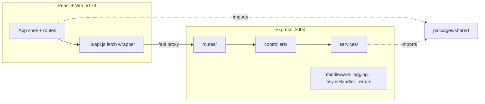

# State of GitJira — after Sprint 01

**Tag:** `sprint-01` · **PR:** #8 · **Version:** 0.0.1

## What the system can do

Nothing a user would call a feature — and that is the correct outcome. The walking
skeleton proves the architecture end to end: a React shell calls a layered Express API
through a dev proxy and renders its health in the footer. Every future sprint plugs into
seams that now exist.

## Architecture

## Metrics

| Metric            | Value                          |
| ----------------- | ------------------------------ |
| Endpoints         | 1 (`GET /api/health`)          |
| Test coverage     | n/a — runner arrives sprint 02 |
| Web bundle (gzip) | 55 kB                          |
| CI pipeline       | ~1m20s (install 9s warm)       |

## Tech-debt register

| Debt                                   | Why accepted                                                                                                            | Due when      |
| -------------------------------------- | ----------------------------------------------------------------------------------------------------------------------- | ------------- |
| No tests                               | Nothing worth testing yet; harness is sprint 02's first job (incl. the asyncHandler regression test promised in review) | Sprint 02     |
| Client filter/search absent everywhere | No data exists                                                                                                          | Sprints 03–06 |

## Known limitations

No persistence, no auth, no product surface. Docker Compose infra is staged but unused.
