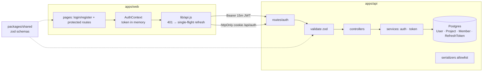

# State of GitJira — after Sprint 02

**Tag:** `sprint-02` · **PR:** #17 · **Version:** 0.0.2

## What the system can do

Users register, log in, stay logged in for a week (silently refreshed 15 minutes at a
time), and log out. Sessions survive reloads, resist XSS token theft, and self-destruct
if a refresh token is ever replayed. There is still nothing to track — projects/issues
data exists only via the seed.

## Architecture (delta from sprint 01)

## Metrics

| Metric            | Value                       | Sprint 01 |
| ----------------- | --------------------------- | --------- |
| Endpoints         | 6                           | 1         |
| Tests             | 16 (13 api + 3 web)         | 0         |
| Web bundle (gzip) | 84 kB                       | 55 kB     |
| CI                | ~1m (with postgres service) | ~1m20s    |

## Tech-debt register

| Debt                          | Why accepted                                    | Due when                        |
| ----------------------------- | ----------------------------------------------- | ------------------------------- |
| TRUNCATE-based test isolation | Suite is small; rollback isolation is sprint 11 | Sprint 11                       |
| No rate limiting on login     | Internal tool behind VPN; tracked as exercise   | Sprint 13                       |
| Roles stored but unenforced   | No resources to protect yet                     | Sprint 03 (checks), 13 (matrix) |

## Known limitations

No password reset (needs email pipeline, sprint 09). Revoked users keep access tokens
for ≤15 min (ADR 0004, accepted). No projects/issues UI yet.
