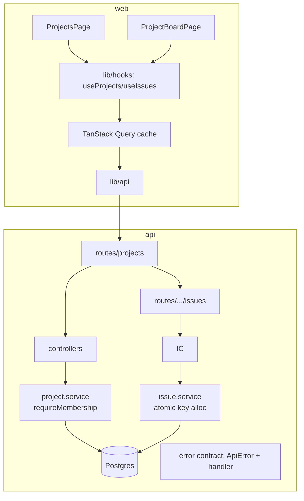

# State of GitJira — after Sprint 03

**Tag:** `sprint-03` · **PR:** #27 · **Version:** 0.0.3

## What the system can do

The product exists. A logged-in user creates projects (auto-seeded with To Do / In
Progress / Done columns), invites teammates with roles, and files/edits/assigns issues
that carry real keys (GJ-1, GJ-2, …). A filterable table lists them, paginated by cursor.
Members of one project cannot see or touch another's — verified by a test matrix.

## Architecture (delta)

## Metrics

| Metric             | Value               | Prev                 |
| ------------------ | ------------------- | -------------------- |
| Endpoints          | 14                  | 6                    |
| Tests              | 27 (24 api + 3 web) | 16                   |
| Issue list payload | 0.21 KB/issue       | 1.42 KB (pre-review) |
| Web bundle (gzip)  | 98 kB               | 84 kB                |

## Tech-debt register (delta)

| Debt                                         | Why                                   | Due                                |
| -------------------------------------------- | ------------------------------------- | ---------------------------------- |
| Unknown-field strictness undecided on writes | Per-endpoint judgment, tracked in #28 | when a typo-masks-bug case appears |
| Client-side type filter only                 | Server filtering + JQL is sprint 06   | Sprint 06                          |
| No board UI yet                              | Sprint 04                             | Sprint 04                          |

## Known limitations

No board, no issue detail/comments, no search. Column management (rename/reorder) not yet
exposed. Delete has no confirm dialog.
