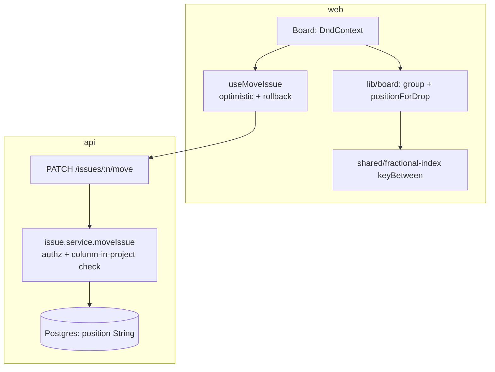

# State of GitJira — after Sprint 04

**Tag:** `sprint-04` · **PR:** #39 · **Version:** 0.0.4

## What the system can do

The board is live. Cards drag between columns and reorder within them, moving the instant
you drop them (optimistic) and snapping back if the server rejects. Ordering uses fractional
keys, so a move writes one row. Keyboard users can move cards too, with spoken announcements.
Board and table are two views of the same issues.

## Architecture (delta)

## Metrics

| Metric                              | Value                          | Prev  |
| ----------------------------------- | ------------------------------ | ----- |
| Endpoints                           | 15                             | 14    |
| Tests                               | 43 (30 api + 8 web + 5 shared) | 27    |
| fractional-index max key (5000 ins) | length 5                       | —     |
| Web bundle (gzip)                   | 117 kB                         | 98 kB |

## Tech-debt register (delta)

| Debt                                | Why                                 | Due                                   |
| ----------------------------------- | ----------------------------------- | ------------------------------------- |
| No fractional-key rebalancing       | Keys grow slowly; fine at our scale | if keys get pathologically long       |
| Last-write-wins on concurrent moves | Single-dragger assumption           | Sprint 08 (real-time + preconditions) |

## Known limitations

No issue detail/comments yet (sprint 05). Column management (rename/reorder/add) not exposed.
Two users dragging the same card can tie until refresh.
