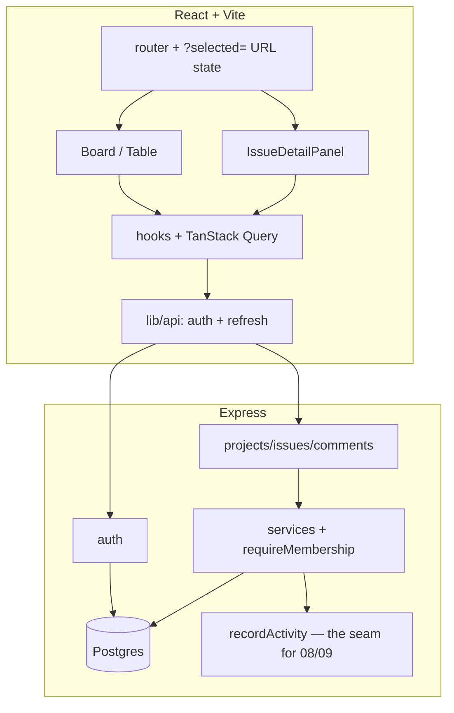

# State of GitJira — after Sprint 05 (v0.1.0 MVP)

**Tag:** `v0.1.0` / `sprint-05` · **PR:** #49 · **Version:** 0.1.0

## What the system can do

A working single-team issue tracker. Register and log in; create projects and invite
teammates with roles; file, assign, and prioritize issues that carry real keys; work them
on a drag-and-drop board with instant moves; open any issue in a URL-addressable panel to
edit it, discuss it in comments, break it into sub-tasks, and read its activity history.
Deep-link to any issue; hit a 404 instead of a blank screen. **This is the MVP.**

## Architecture (MVP complete)

## Metrics

| Metric            | Value                           | Prev   |
| ----------------- | ------------------------------- | ------ |
| Endpoints         | 22                              | 15     |
| Tests             | 44 (34 api + 10 web + 5 shared) | 43     |
| Migrations        | 6                               | 4      |
| Web bundle (gzip) | 119 kB                          | 117 kB |

## Tech-debt register (carried into Phase 2)

| Debt                                                    | Why                                    | Due                            |
| ------------------------------------------------------- | -------------------------------------- | ------------------------------ |
| Attachment download authenticates but doesn't authorize | Added late; object-level check missing | **Sprint 13** (security audit) |
| Plain-text descriptions/comments                        | Rich text needs mentions+sanitization  | Sprint 09 / 13                 |
| Client-side type filter only                            | Server filtering + JQL                 | Sprint 06                      |
| Unknown-field strictness undecided (#28)                | Per-endpoint call                      | when it bites                  |

## Known limitations

No search/JQL, no real-time, no notifications, no backlog/sprints — that's Phase 2.
Attachments have a known authorization gap slated for the security sprint.
