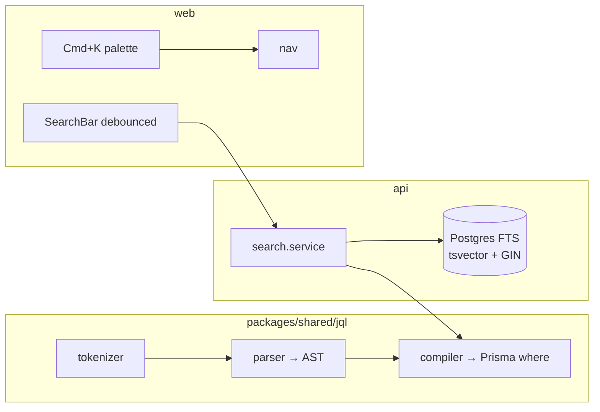

# State of GitJira — after Sprint 06 (v0.2.0)

**Tag:** `v0.2.0` / `sprint-06` · **PR:** #57 · **Version:** 0.2.0

## What the system can do
Everything from the MVP, plus real search: type JQL like `type = bug AND assignee = me`,
free-text search across titles and descriptions, save filters, and jump anywhere with Cmd+K.
Filtering is fully server-side now (the client type dropdown is gone).

## Architecture (delta)

## Metrics
| Metric | Value | Prev |
|---|---|---|
| Endpoints | 26 | 22 |
| Tests | 71 (40 api + 10 web + 21 shared) | 44 |
| Migrations | 8 | 6 |
| Web bundle (gzip) | 120 kB | 119 kB |

## Tech-debt register (delta)
| Debt | Why | Due |
|---|---|---|
| Other raw queries not audited | Only the FTS query was parameterized this sprint | Sprint 13 (full injection pass) |
| Prisma + generated tsvector drift | Prisma re-emits spurious ALTERs; hand-corrected per migration | tolerate; documented |
| JQL: no ORDER BY / functions | Subset by design | when users ask |

## Known limitations
Search is per-project (membership still applies). No typo tolerance / fuzzy matching
(Postgres FTS ceiling). Real-time, notifications, and sprints are still Phase 2 ahead.
