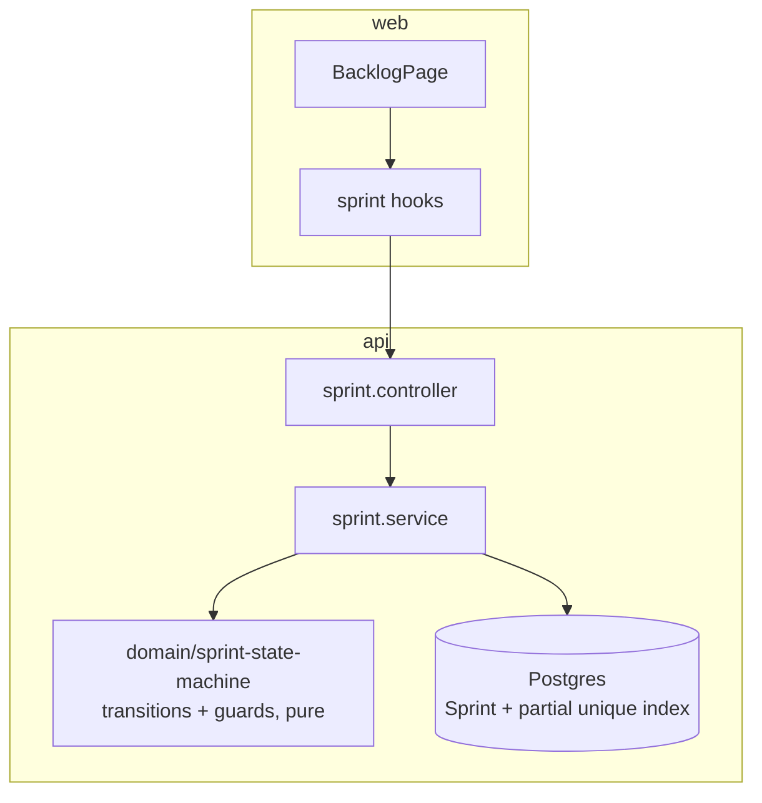

# State of GitJira — after Sprint 07 (v0.3.0)

**Tag:** `v0.3.0` / `sprint-07` · **PR:** #66 · **Version:** 0.3.0

## What the system can do

Everything from before, plus agile planning: a backlog to hold un-started work, sprints
modeled as an explicit state machine (planned → active → completed), the ability to plan a
sprint, start it (with "one active per project" enforced by the database), work it on the
board, and complete it — rolling unfinished issues to the backlog or the next sprint,
atomically — with a committed-vs-completed points report.

## Architecture (delta)

## Metrics

| Metric     | Value                            | Prev |
| ---------- | -------------------------------- | ---- |
| Endpoints  | 32                               | 26   |
| Tests      | 85 (54 api + 10 web + 21 shared) | 71   |
| Migrations | 9                                | 8    |

## Tech-debt register (delta)

| Debt                                             | Why                                         | Due               |
| ------------------------------------------------ | ------------------------------------------- | ----------------- |
| No cross-sprint velocity chart                   | Needs multiple completed sprints of history | when there's data |
| Backlog ranking is create-order, not drag-ranked | Fractional-index drag deferred              | polish            |

## Known limitations

Epics exist as an issue type but epic-progress rollup UI is minimal. No real-time yet —
that's next sprint, and it's where the activity-event seam from sprint 05 finally gets a consumer.
