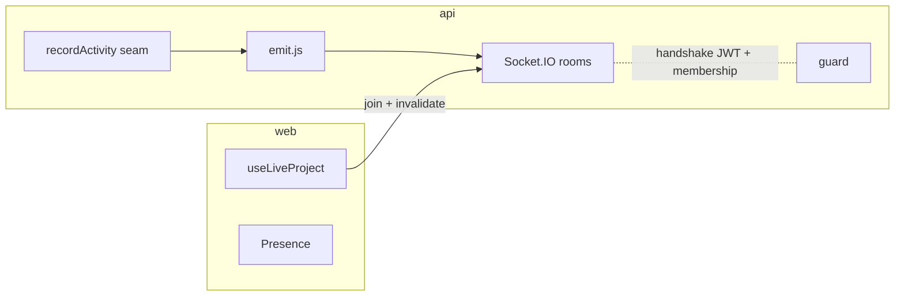

# State of GitJira — after Sprint 08 (v0.4.0)

**Tag:** `v0.4.0` / `sprint-08` · **PR:** #74 · **Version:** 0.4.0

## What the system can do

Everything before, now live: two people on the same board see each other's changes without
refreshing, a presence row shows who's viewing, and concurrent edits to the same issue get a
"this changed, reload" instead of a silent clobber. Built on Socket.IO with one room per
project, fed by the activity seam from sprint 05.

## Architecture (delta)

## Metrics

| Metric   | Value                                  | Prev |
| -------- | -------------------------------------- | ---- |
| Tests    | 92 (61 api + 10 web + 21 shared)       | 85   |
| Realtime | Socket.IO, per-project rooms, presence | —    |

## Tech-debt register (delta)

| Debt                                   | Why                        | Due                 |
| -------------------------------------- | -------------------------- | ------------------- |
| Single-node sockets (no Redis adapter) | One instance for now       | Sprint 15 (scaling) |
| Reconnect refetches everything         | Can't replay missed events | acceptable          |

## Known limitations

No notifications yet (email/in-app) — that's sprint 09, and it's the SECOND consumer of the
same activity seam. Sockets don't scale past one node until the Redis adapter lands.
