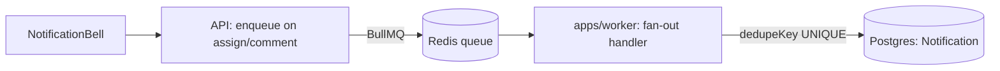

# State of GitJira — after Sprint 09 (v0.5.0)

**Tag:** `v0.5.0` / `sprint-09` · **PR:** #82 · **Version:** 0.5.0

## What the system can do

Notifications, done properly. Assigning an issue or @mentioning someone returns instantly;
a separate worker process fans out notifications to the assignee, watchers, and mentioned
users. An in-app bell shows the unread count and list. Watching is automatic on interaction
plus a manual toggle. The fan-out is idempotent — a retried job never double-notifies.

## Architecture (delta)

## Metrics

| Metric     | Value                            | Prev |
| ---------- | -------------------------------- | ---- |
| Apps       | 3 (web, api, worker)             | 2    |
| Tests      | 97 (66 api + 10 web + 21 shared) | 92   |
| Migrations | 10                               | 9    |

## Tech-debt register (delta)

| Debt                        | Why                                        | Due                   |
| --------------------------- | ------------------------------------------ | --------------------- |
| No real email delivery      | Pipeline built for it; in-app only for now | when an ESP is chosen |
| No digest batching          | Bursts create N notifications              | polish                |
| No notification preferences | Per-type mute deferred                     | exercise / later      |

## Known limitations

Email is a drop-in away but not wired. No cross-sprint velocity or reports beyond the basic
sprint report. Next: the TypeScript migration — the whole codebase, incrementally.
