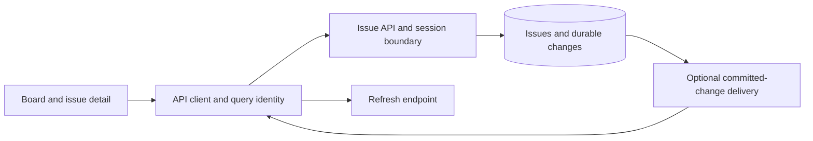

# Worked design: Design coherent issue views, session recovery, and notification-driven refresh

## Start with a bounded user journey

A contributor edits an issue while board and detail views are open. The session may expire during the request. The contributor sees one truthful mutation outcome, and both relevant projections refresh under the active session identity.

The invariant is: **An issue mutation changes only permitted fields in its scope, and each affected view eventually reflects the accepted result without an obsolete session or query response taking ownership.**

Non-goals: Do not rebuild an enterprise work-management suite, introduce event sourcing solely to refresh a board, or promise that one browser refresh gate coordinates every tab and server process.

Before choosing infrastructure, write three acceptance examples: an ordinary successful operation, a repeated or conflicting operation, and an unavailable dependency. Define what the user can still do in each case. A phrase such as highly available is incomplete until you name the operation and the behavior allowed when a dependency fails.

## Worked target architecture

This is the teaching design to evaluate, not a deployment inventory. [Source observations](README.md) distinguish what is present from what is proposed.

Separate three identities: the issue or project scope, the current authenticated session, and one mutation intent. Sharing a refresh promise addresses overlapping refresh work inside its owner; it does not decide whether an old refresh response should still be applied after logout. A session generation or equivalent current-owner check is a proposed extension to reason about that race, not a claim that the inspected wrapper already contains it.

PATCH semantics stay in the shared public contract. Omission preserves a field while explicit null or zero follows the field's rule. The server constructs allowed updates rather than spreading arbitrary client fields into persistence. If optimistic concurrency is adopted, the expected version must participate in the authoritative write.

After a commit, update or invalidate every affected query projection. Moving an issue out of an open filter affects both its detail and its previous list membership. A notification can be a hint to refetch rather than a complete replacement record. That choice reduces payload coupling but shifts work to the read path and requires handling missed or duplicated hints.

If durable change delivery is needed, couple change intent to the database commit and let delivery retry separately. The browser should reconcile from an authorized current snapshot after reconnect. Do not make mutation success depend on every currently connected browser successfully refreshing.

## Read the diagram as a set of obligations

For each arrow, state the caller, trust context, timeout or transaction boundary, and observable outcome. Label a database write differently from a notification hint or a local draft update. A line crossing into a worker or provider is a potential failure window; it does not inherit atomicity from an earlier database transaction.

Choose one authoritative record for each decision. Derived caches and UI projections can be rebuilt only if the source of truth and reconstruction policy are clear. A read replica or cached response can be appropriate for some reads while being inappropriate for the admission decision that protects the invariant. Name that distinction before adding either component.

## First implementation slice and later growth

The first proposed slice should support the bounded journey with the existing architecture wherever possible. Include contract validation, authorization, the decisive state transition, a truthful response, and the focused regression that rejects the named failure. If the existing code already meets the behavior, the useful work is characterization and evidence rather than replacement.

Scale in response to a specific bottleneck. More stateless API instances may help request handling while leaving a hot row, connection limit, provider quota, or downstream queue unchanged. A queue can smooth a burst but cannot make sustained arrival exceed processing capacity indefinitely. A cache can reduce eligible reads but adds identity and freshness obligations.

Explain one alternative that could be correct under different requirements. Use the [decision record](05-design-decisions.md) to state the cost of your choice and the observation that would make you reconsider it. The goal is a design another engineer can challenge with a concrete failure, not the largest possible collection of boxes.
